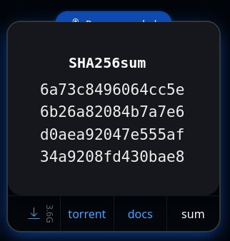
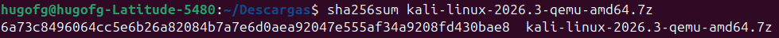
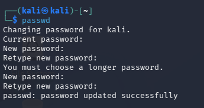
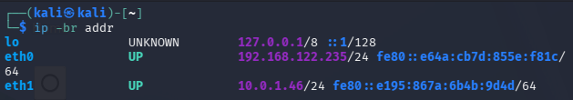
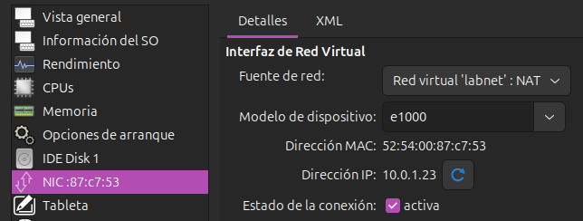
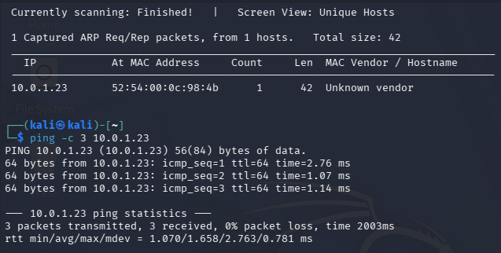
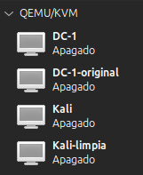

# LABORATORIO 00

## EVIDENCIAS

### H1 · Comprobar los requisitos
Ubuntu tiene la virtualización activada por defecto

### H2 · Instalar VirtualBox e importar Kali

### H3 · Crear la red aislada `labnet`

### H4 · Importar la máquina víctima DC-1

### H5 · Comprobar la conectividad

### H6 · Tomar instantáneas

> Nota: QEMU/KVM no permite realizar instantáneas como tal, por lo que he clonado las máquinas para mantener el estado.

## PREGUNTAS
- **¿Por qué DC-1 no debe tener adaptador NAT ni puente?**  
Porque DC-1 es una máquina vulnerable y si tuviese salida a internet sería un peligro para toda la red ya que atacantes reales podrían acceder a ella.

- **¿Para qué sirve el servidor DHCP que creaste en H3?**  
Permite asignar IPs a las máquinas que se conecten a la red interna de forma dinámica, evitando así configuraciones manuales y posibles conflictos entre IPs; además de aumentar el realismo del laboratorio para que los comportamientos sean mucho más similares a entornos reales.

- **¿Qué hacen netdiscover y ping, y qué información te dio cada uno?**  
    - `netdiscover` muestra las IPs y otra información de los dispositivos conectados a la misma red que la máquina. 
    En este caso mostró la IP de la máquina DC-1 conectada a labnet.
    - `ping` envía una señal a la IP indicada y pide una respuesta para comprobar que la otra máquina está conectada y responde correctamente. De esta manera pude comprobar que DC-1 estaba bien conectada y respondía.

## BITÁCORA IA:
Al finalizar la práctica probé a hacer un ping a la máquina DC-1 desde mi host y vi que sí podía. Le pregunté a la IA si eso era normal y si tenía que realizar algún cambio para asegurarlo.

En la respuesta indicó que es normal que el host pueda hacer ping ya que está configurada como NAT, pero las máquinas no tienen acceso a internet por lo que es totalmente seguro. Indicó que si quería asegurarme de estuviera completamente aislada del host cambiase el modo de forwarding a 'ninguno'.